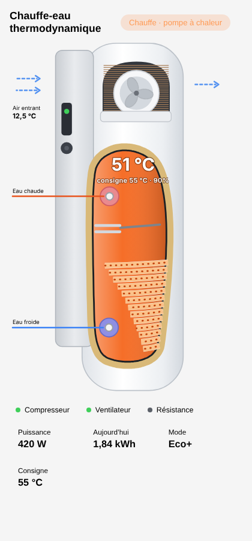

# Carte chauffe-eau thermodynamique pour Home Assistant

Carte animée pour un **chauffe-eau thermodynamique** (dessin d'un Atlantic Explorer V5) : le ventilateur tourne, le serpentin s'anime et l'eau passe du bleu à l'orange selon sa température.

<p align="center"></p>

**Version française** de la carte [atlantic-explorer-card](https://github.com/Yakfeet/atlantic-explorer-card) de Yakfeet (licence MIT), avec :
- toute la carte **en français** (le néerlandais et l'anglais restent disponibles) ;
- un **éditeur visuel** : on choisit ses capteurs dans des listes, sans écrire de YAML ;
- une carte de départ qui reprend automatiquement le premier chauffe-eau (`water_heater`) trouvé.

---

## Installation

### Avec HACS
1. HACS → **⋮** → **Dépôts personnalisés**.
2. Collez l'adresse de ce dépôt, type **Tableau de bord**, puis **Ajouter**.
3. Recherchez **Carte chauffe-eau thermodynamique**, puis **Télécharger**.
4. Rechargez la page du navigateur (Ctrl+F5).

### À la main
1. Copiez `dist/atlantic-explorer-card.js` dans `/config/www/`.
2. **Paramètres → Tableaux de bord → ⋮ → Ressources → Ajouter une ressource** : `/local/atlantic-explorer-card.js`, type **Module JavaScript**.
3. Rechargez la page (Ctrl+F5).

> N'installez pas en même temps la carte d'origine : elles utilisent le même nom.

---

## Utilisation

**Modifier le tableau de bord → Ajouter une carte → « Chauffe-eau thermodynamique (Atlantic Explorer) »**, puis choisissez vos capteurs dans l'éditeur. Ils sont rangés par thème : *Chauffe-eau*, *Pompe à chaleur*, *Énergie*, *États*, *Smart Grid / Boost solaire*.

Seul ce que vous renseignez est affiché : un capteur absent est simplement ignoré. Un clic sur une valeur ouvre la fiche de l'entité.

Exemple en YAML :

```yaml
type: custom:atlantic-explorer-card
title: Chauffe-eau
entities:
  water_heater: water_heater.chauffe_eau     # température, consigne et mode si les capteurs séparés manquent
  tank_temp: sensor.chauffe_eau_temperature
  power: sensor.chauffe_eau_puissance
  energy_today: sensor.chauffe_eau_conso_jour
  air_in: sensor.chauffe_eau_air_entrant
```

### Options

| Option | Rôle | Par défaut |
|---|---|---|
| `title` | Titre de la carte | « Chauffe-eau thermodynamique » |
| `language` | `fr`, `en` ou `nl` | langue de Home Assistant |
| `min_temp` / `max_temp` | Températures « froide » et « chaude » (couleur de l'eau, pourcentage) | 15 / 60 |
| `layout` | `auto`, `horizontal`, `vertical` | `auto` |
| `view` | `full`, `drawing` (dessin seul), `details` (détails seuls) | `full` |
| `grid_mode` | Entrée I1 : `smart_grid` ou `pv_boost` | automatique |
| `element_power` | Puissance (W) au-delà de laquelle la résistance est considérée active, sans capteur `heater` | 800 |
| `reverse_flow` | Inverse le sens des animations | `false` |
| `image` | Image personnalisée de la coupe (`/local/…`) | aucune |
| `labels` | Remplacer n'importe quel texte de la carte | – |

### Capteurs

| Clé | Signification |
|---|---|
| `water_heater` | Entité chauffe-eau (Overkiz / Cozytouch…), utilisée si les capteurs séparés manquent |
| `tank_temp`, `tank_top`, `tank_bottom` | Température de l'eau (milieu, haut, bas du ballon) |
| `hot_out`, `cold_in` | Température de l'eau chaude en sortie, de l'eau froide en entrée |
| `setpoint` | Consigne |
| `air_in`, `air_out` | Air avant et après l'évaporateur |
| `coil`, `exhaust`, `return_gas`, `eev` | Évaporateur, gaz refoulé, gaz aspiré, position du détendeur |
| `power` | Puissance électrique (W) |
| `energy_today`, `energy_month`, `energy_total` | Consommation du jour, du mois, totale (kWh) |
| `cop` | COP du dernier cycle |
| `available_liters`, `remaining_minutes` | Eau chaude disponible (L), autonomie (min) |
| `runtime_defrost` | Temps avant le prochain dégivrage (min) |
| `compressor`, `heater` | Compresseur / résistance en marche. Sans ces capteurs, l'état est déduit de la puissance |
| `defrost`, `online`, `fault`, `away`, `mode` | Dégivrage, en ligne, défaut, absence, mode |
| `pv_boost`, `sg_1`, `sg_2` | Entrées I1 / I2 pour Smart Grid ou Boost solaire |

Sans capteur `compressor`, la pompe à chaleur est considérée en marche au-dessus de 50 W ; sans capteur `heater`, la résistance au-dessus de `element_power`.

---

## Crédits et licence

Carte d'origine : [atlantic-explorer-card](https://github.com/Yakfeet/atlantic-explorer-card) par **Yakfeet**, elle-même inspirée de [AMensink/warmtepomp-cards](https://github.com/AMensink/warmtepomp-cards).
Traduction française et éditeur visuel : **frederic76430**.

Licence [MIT](LICENSE). Les photos produit Atlantic appartiennent à Atlantic : ne les publiez pas dans un dépôt public.
